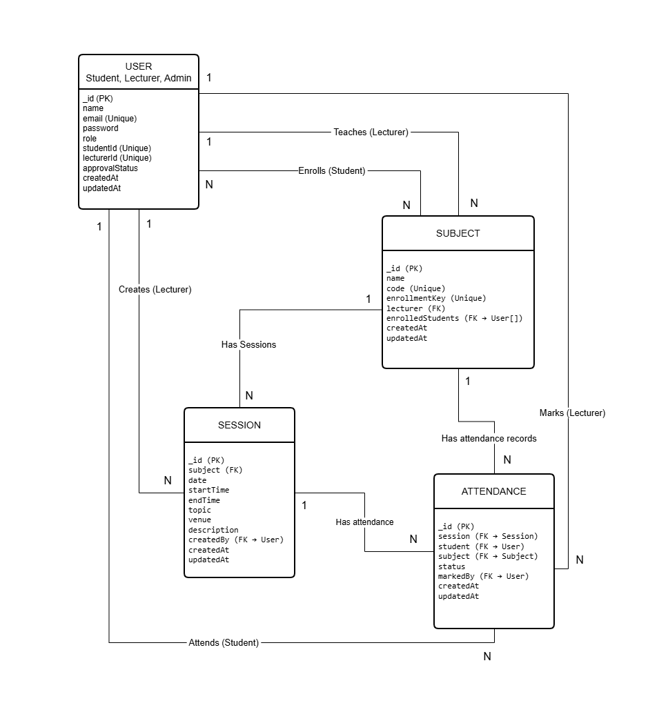

# StudentTrack – Student Attendance Management System

<p align="center">
  
</p>

<p align="center">
  <strong>Student Attendance Management System</strong>
</p>

<p align="center">
  A web-based application designed to simplify student attendance management.
</p>

---

## 1. Project Overview

StudentTrack is a web-based Student Attendance Management System developed to simplify and digitalize attendance management in educational institutions.

The system provides separate functionalities for Administrators, Lecturers, and Students. Administrators can manage users and subjects, Lecturers can manage sessions and record student attendance, while Students can view their enrolled subjects and monitor their attendance records.

The application aims to reduce manual attendance management, improve accuracy, and provide convenient access to attendance information.

## 2. Key Features

### 2.1 Authentication and User Management
- Student and Lecturer registration.
- Secure user login and logout.
- JWT-based authentication.
- Password hashing.
- Role-based access control.
- Admin approval for new registrations.
- Registration status management.

### 2.2 Admin Features
- View registered users.
- Approve or reject registration requests.
- View and manage registered subjects.
- Create, update, and delete subjects.
- Assign lecturers to subjects.
- View attendance statistics.
- Monitor overall system information.

### 2.3 Lecturer Features
- View assigned subjects.
- View subject details.
- Create and manage class sessions.
- Set session dates, times, topics, and venues.
- Mark student attendance as Present, Absent, or Late.
- Update attendance records.
- View attendance summaries.
- View individual student attendance percentages.

### 2.4 Student Features
- Join subjects using enrollment keys.
- View enrolled subjects.
- View upcoming sessions.
- View attendance records.
- Monitor attendance percentages.
- View attendance history for individual subjects.

## 3. Technologies Used

| Component | Technologies |
|---|---|
| Frontend | React, Vite |
| Styling | Tailwind CSS |
| Routing | React Router |
| HTTP Client | Axios |
| Icons | Lucide React |
| Backend | Node.js, Express.js |
| Database | MongoDB |
| ODM | Mongoose |
| Authentication | JSON Web Tokens (JWT) |
| Password Security | bcryptjs |

## 4. Project Structure

The project is organized into two main directories: `Frontend` and `Backend`.

```text
Student_Attendence_Tracker/
│
├── Backend/
│   ├── controllers/
│   ├── middleware/
│   ├── models/
│   ├── routes/
│   ├── .env
│   ├── createAdmin.js
│   ├── server.js
│   ├── package.json
│   ├── package-lock.json
│   └── .gitignore
│
├── Frontend/
│   ├── public/
│   ├── src/
│   │   ├── assets/
│   │   ├── pages/
│   │   ├── services/
│   │   ├── App.jsx
│   │   ├── index.css
│   │   └── main.jsx
│   ├── index.html
│   ├── package.json
│   ├── package-lock.json
│   ├── vite.config.js
│   ├── eslint.config.js
│   └── .gitignore
│
└── README.md
```

### Folder Descriptions

- `Backend/controllers/` - Handles application request processing logic. 
- `Backend/middleware/` - Contains authentication and authorization middleware. 
- `Backend/models/` - Contains MongoDB data models. 
- `Backend/routes/` - Defines backend API routes. 
- `Backend/server.js` - Configures and starts the Express server. 
- `Frontend/src/assets/` - Stores images and other frontend assets. 
- `Frontend/src/pages/` - Contains application pages for different user roles. 
- `Frontend/src/services/` - Handles API communication. 
- `Frontend/src/App.jsx` - Main React application component. 
- `Frontend/src/main.jsx` - Frontend application entry point. 

## 5. Installation and Setup

### 5.1 Prerequisites

- Node.js
- npm (Node Package Manager)
- MongoDB database
- Git

### 5.2 Clone the Repository

Clone the project repository:
```bash
git clone https://github.com/GithmiJayakody/Student_Attendence_Tracker.git
```

Navigate to the project directory:
```bash
cd Student_Attendence_Tracker
```

### 5.3 Backend Setup

Navigate to the Backend directory:
```bash
cd Backend
```

Install the backend dependencies:
```bash
npm install
```

Create a `.env` file inside the Backend directory and configure the following environment variables:

```env
MONGO_URI=your_mongodb_connection_string
JWT_SECRET=your_secret_key
PORT=5000
```

**Important:** Replace the example values with your actual configuration. Never commit the `.env` file to GitHub. 

The `.env` file should be created locally inside the `Backend` directory. It is excluded from version control to protect sensitive credentials.

Start the backend development server:
```bash
npm run dev
```

The backend server runs on port `5000` when successfully connected to MongoDB.

### 5.4 Frontend Setup

Open another terminal and navigate to the Frontend directory:
```bash
cd Frontend
```

Install the frontend dependencies:
```bash
npm install
```

Start the frontend development server:
```bash
npm run dev
```

Vite will display a local development URL in the terminal. Open that URL in a web browser to access StudentTrack.

## 6. API Endpoints

The backend provides the following main API route groups:

- `/api/auth` - User registration and authentication 
- `/api/subjects` - Subject management 
- `/api/sessions` - Class session management 
- `/api/attendance` - Attendance management 
- `/api/admin` - Administrative operations 
- `/api/admin/attendance` - Administrative attendance operations 

## 7. Security Features

StudentTrack incorporates the following security mechanisms:

- Passwords are hashed using bcryptjs before being stored.
- JWT is used to authenticate users.
- Role-based authorization restricts access to protected resources.
- New student and lecturer registrations require administrator approval.
- Environment variables are used to manage sensitive configuration details.

## 8. User Interface

StudentTrack provides separate, responsive interfaces for Administrators, Lecturers, and Students.

The application is designed to support desktop and mobile screen sizes.


## 9. Database

StudentTrack uses MongoDB as its database and Mongoose for data modeling and database operations.

The database stores application information such as:
- User accounts and roles.
- Subject information.
- Class session details.
- Student attendance records.


## 10. Entity Relationship Diagram

The following diagram illustrates the database structure and relationships of the StudentTrack system.




## 11. Development

**Name:** Githmi Jayakody

**Project Name:** StudentTrack – Student Attendance Management System

**Institution:** Faculty of Engineering, University of Ruhuna, Sri Lanka.

**Module:** EC4307 – Web Application Development


---

<p align="center">
  
</p>

<p align="center">
  <em>Smarter Attendance for a Brighter Future.</em>
</p>


